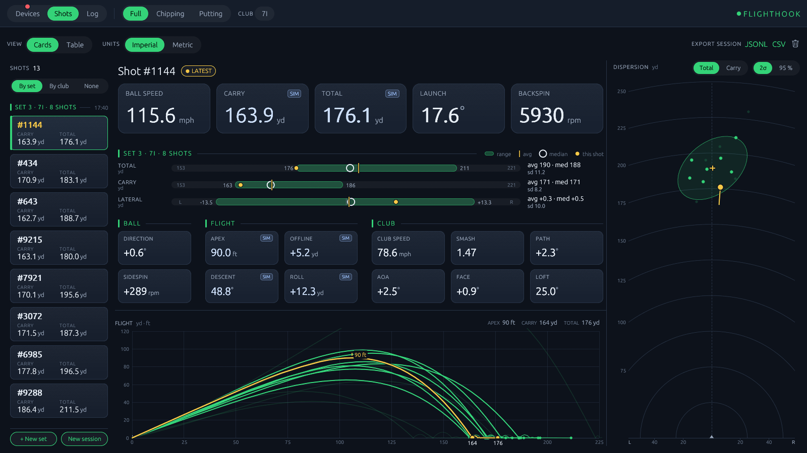
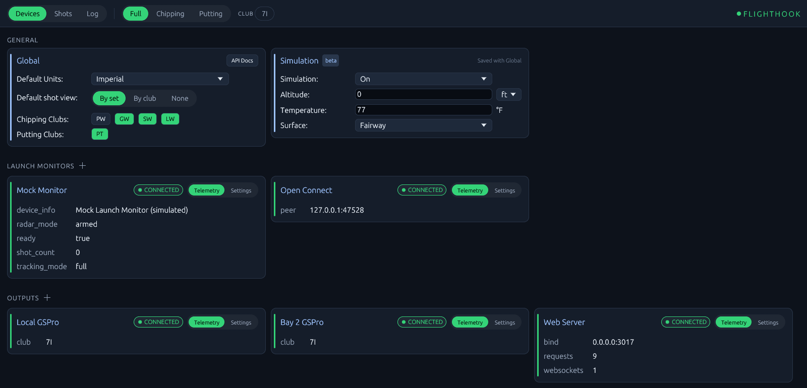
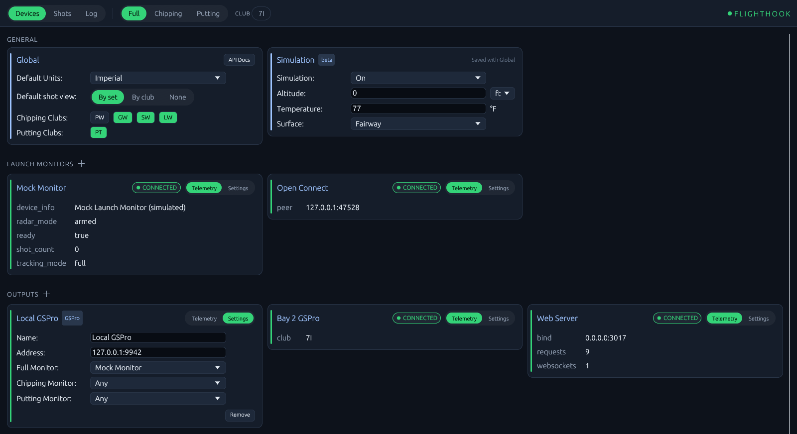
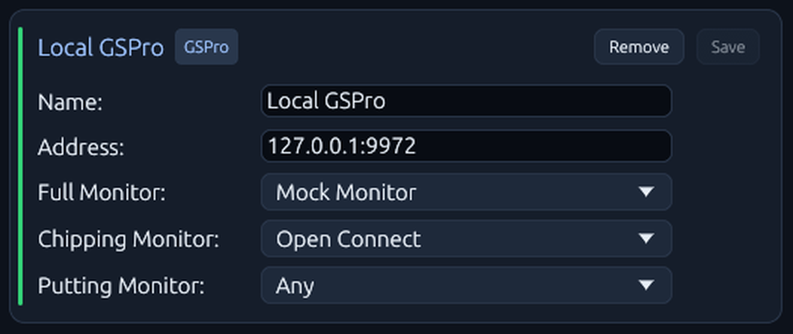

# flighthook

[](https://github.com/divotmaker/flighthook/actions/workflows/ci.yml)
[](https://crates.io/crates/flighthook)
[](https://docs.rs/flighthook)

Acts as a bridge between golf launch monitors and simulation software.
Connects to launch monitors, decodes shot data, and forwards it to integrations like GSPro.
Provides a REST and WebSocket API for custom integrations to participate on the central event bus.

## Supported Integrations

### Launch Monitors

Each device links to its setup notes, quirks, and config reference.

| Device                                               | Protocol                | Driver                                          | Status           |
| ---------------------------------------------------- | ----------------------- | ----------------------------------------------- | ---------------- |
| [FlightScope Mevo+](docs/devices/flightscope.md)     | TCP (binary, port 5100) | [ironsight](https://crates.io/crates/ironsight) | Supported        |
| [FlightScope Mevo Gen2](docs/devices/flightscope.md) | TCP (binary, port 5100) | [ironsight](https://crates.io/crates/ironsight) | Supported        |
| [FlightScope Xi](docs/devices/flightscope.md)        | TCP (binary, port 5100) | [ironsight](https://crates.io/crates/ironsight) | Supported        |
| [Square Golf Omni](docs/devices/square-golf.md)      | BLE (GATT)              | [allsquare](https://crates.io/crates/allsquare) | Supported        |
| [Garmin R10](docs/devices/garmin-r10.md)             | BLE / GFDI / Protobuf   | [tenover](https://crates.io/crates/tenover)     | Alpha            |
| [Uneekor](docs/devices/uneekor.md)                   | TCP (JSON, port 921)    | built-in (OpenConnect server)                   | Alpha (untested) |

Uneekor connects through the **OpenConnect server** actor, which accepts shots
from any launch monitor that speaks GSPro Open Connect as a client — Foresight,
SkyTrak and MLM2PRO also emit it. Add it from the Launch monitors (+) menu:
**Uneekor (OpenConnect)**, or **OpenConnect Server** for any other monitor.

### Simulation Software

| Software  | Protocol              | Driver                        | Status           |
| --------- | --------------------- | ----------------------------- | ---------------- |
| GSPro     | TCP (JSON, port 921)  | built-in (OpenConnect client) | Supported        |
| Muni Golf | TCP (JSON, port 9210) | built-in (OpenConnect client) | Alpha (untested) |

Simulators are reached through the **OpenConnect client** output, which sends
shots to any simulator that accepts GSPro Open Connect. The OpenConnect client
and server are the two halves of the same protocol. Add one from the Outputs
(+) menu: **GSPro (OpenConnect)**, **Muni Golf (OpenConnect)**, or
**OpenConnect Client** for any other simulator.

### Custom Integrations

flighthook exposes a REST + WebSocket API on the event bus, so any external software can subscribe to shot data, device telemetry, and raw audit events. See [docs/API.md](docs/API.md).

#### Flight Relay Protocol

The WebSocket API speaks the [Flight Relay Protocol](https://github.com/flightrelay/spec)
(FRP) — an open, vendor-neutral protocol for launch monitor shot data. flighthook
serves it at `ws://<host>:5880/frp` and negotiates the spec version on connect,
currently `0.1.0`.

Whatever the monitor is — a Mevo+ over its binary TCP protocol, an R10 over BLE,
a Uneekor over OpenConnect — it is normalised into the same FRP event stream, so
a consumer is written once rather than per device.

The shot lifecycle events (`shot_trigger`, `ball_flight`, `club_path`,
`face_impact`, `shot_finished`) and the device events (`device_telemetry`,
`alert`) are FRP-compliant and use the spec's own field shapes; the types come
from the [`flightrelay`](https://crates.io/crates/flightrelay) crate. flighthook
adds its own event kinds alongside them (player/club info, config commands, actor
status, shot groups), which FRP-only consumers ignore per spec.

The spec is CC0 and the Rust SDK is Apache-2.0/MIT, so consumers need not depend
on flighthook itself.

## Status

**Beta (0.1.x)** — The API, configuration format, and WebSocket protocol are usable but may still change. Breaking changes will be noted in release notes.

## Install

Download the binary for your platform from the
[latest release](https://github.com/divotmaker/flighthook/releases/latest):
`flighthook-linux-x86_64`, `flighthook-windows-x86_64.exe`, or
`flighthook-macos-aarch64` (Apple Silicon).

### macOS

The macOS binary is not signed, so a copy downloaded with a browser is
quarantined and Gatekeeper refuses to open it. Download it with `curl`
instead, which does not quarantine it:

```sh
curl -LO https://github.com/divotmaker/flighthook/releases/latest/download/flighthook-macos-aarch64
chmod +x flighthook-macos-aarch64
./flighthook-macos-aarch64
```

If you already downloaded it with a browser, remove the quarantine flag first:

```sh
xattr -d com.apple.quarantine flighthook-macos-aarch64
chmod +x flighthook-macos-aarch64
```

The first time flighthook connects to a Bluetooth device (e.g. Square Golf),
macOS asks for Bluetooth permission for the app that launched it, such as
Terminal. Allow it.

## Features

- Multi-device support
- Automatic detection mode switching based on club selection (full / chipping / putting)
- Club selection is forwarded to devices that use it — the Square Golf Omni has no
  separate putting mode, so selecting a putter in the sim puts it in putting mode
- Simulated carry, apex, descent, offline, roll and total for launch monitors that
  measure launch only (beta) — see [Simulated values](#simulated-values-beta)
- Shot metrics computed from the measured values: total spin and spin axis,
  face to path, spin loft and curve — see [Shot metrics](#shot-metrics)
- Shot sets: every shot joins a set, and a club change or **+ New set** starts
  a new one — see [Shot Tracking](#shot-tracking)
- Flight chart: a side view of the simulated ball flights of the shown shot's
  set or club, drawn as smooth curves, with the rest of the session faint
  behind (beta)
- Dispersion chart: a top-down view of where those shots came to rest or
  landed, with a 2σ or 95 % dispersion ellipse (beta)
- One fixed Shots layout with both charts always on screen, sized from the
  window
- Export the session as JSONL with the raw device frames behind each shot, or CSV
- Dual UI: native desktop window (eframe/egui) and browser dashboard (WASM, same codebase)
- The UI scales itself to fit the window, so a 4K screen at 100 % shows about the
  same layout as at 200 %; in the desktop app Ctrl/Cmd + `+` / `-` adjust it and
  Ctrl/Cmd + `0` resets it (beta)
- Configurable via TOML file with live settings updates
- REST + WebSocket API for external consumers — subscribe to shot data, device telemetry, and raw audit events in real time. Build custom shot triggers, data loggers, or alternative integrations without touching the core.

### Simulated values (beta)

When a launch monitor doesn't report carry, apex, flight time, descent angle,
offline, roll or total, flighthook simulates them from the measured launch (ball
speed, launch angle, launch direction, backspin, sidespin) with the
[dimple](https://crates.io/crates/dimple) ball-flight model: modern tour ball,
flat fairway, sea level and 25 °C by default.

`[simulation] mode` (Devices tab → General → Simulation card) picks what is simulated:

- `off`: nothing; flighthook shows only what the launch monitor reports.
- `on` (the default): flighthook fills what the device didn't report, plus
  the ground-ball and zero-reading cases below, and never changes what the
  device sent.
- `force`: every simulated shot gets all its results (carry, apex, flight
  time, descent, offline, roll, total) from the simulation of its measured
  launch, for every device; `derived` carries all of them, flagged
  `replaces_measured`, and they take precedence over the device's. The
  device's own results are kept, unchanged, under `ball` and in the export,
  and GSPro still receives the device's data. Launch values (ball speed,
  launch angles, spin, club data) are never replaced. A shot that can't be
  simulated keeps the device's results.

- Simulated values are marked `derived` in the API, shown with a `SIM` tag on
  the dashboard's cards and in *italics* in its table, and logged as
  `sim (estimated, beta)` under the device's ball line.
- The dashboard (cards, shot list, table, range bars and their stats, both
  charts) shows the simulated value when there is one, still marked as
  simulated, else the device's. flighthook simulates a value the device
  reported only when the simulated one is the one to show: a ground ball's 0
  carry, apex and flight time (and its roll, which is its total), a 0 carry or
  flight time on a shot that flies, and every result on a `force` shot.
- They are **never sent to GSPro**, which simulates the flight itself.
- Offline is the distance right (+) or left (−) of the target line. Roll is
  negative when the ball spins back toward the tee.
- When the device measures carry, total is that measured carry plus the
  simulated roll; when it measures carry and total but not roll, roll is the
  total minus the carry.
- A shot is flown only when the device reports all five launch values, the
  ball speed is above 0, the launch angle is between 0° and 90°, and the
  launch direction is within ±90°. A shot with no spin reading (back and side
  both 0) is not flown. A slow, low chip with some lift flies.
- A ground ball is rolled, not flown: a shot whose measured apex is 0, or,
  from a device that reports no apex, one launched at 0.5° or less. Putts and
  bladed shots alike, whatever the club or detection mode. Carry, apex and
  flight time are 0, and roll and total come from a roll from the tee, from
  the ball speed and direction (a measured total wins). In Putting mode the
  ball rolls on a green (the configured surface if it is a green); in any
  other mode on the configured surface (fairway by default).
- On a shot that flies, a measured carry or flight time of 0 is not a
  reading: flighthook simulates it like a missing value.
- A FlightScope chip reported with launch data but no spin and no carry gets
  an estimated backspin and is flown; see
  [Launch-only chips](docs/devices/flightscope.md#launch-only-chips-beta).
- A measured carry offline or descent angle (FlightScope full results) is
  kept. The simulated path still leaves the tee on the measured launch
  direction and is fitted to land on the measured offline, by scaling its
  curve off that start line.

Carry is fitted to Trackman PGA Tour averages (about 3 yd RMSE). Roll and
total are beta in dimple: only a drive's run is compared with measured
fairway data (a tour-average drive runs about 18 yd, between the USGA/R&A
proposed bounce model and the ShotLink median for its landing angle), and no
published wedge, pitch or chip run on a fairway exists to compare against,
so treat them as estimates. Known model limits are listed in dimple's
[AERO.md](https://github.com/divotmaker/dimple/blob/main/docs/AERO.md). When
comparing against another launch monitor, set altitude and temperature to its
normalization conditions.

Settings live under `[simulation]` (all keys optional) or in the Devices tab's Simulation card:

```toml
[simulation]
mode = "on"               # off | on | force
altitude = "0ft"          # any distance unit, 0 to 5000 m
temperature_c = 25.0      # -30 to 50
surface = "fairway"       # fairway | green | firm_green
```

The mode applies per shot: changing it affects new shots only. An altitude or
temperature outside its range turns simulation off (with a warning in the
log) until it is fixed. Changes apply from the next shot, without a restart.

### Shot metrics

A finished shot carries `metrics`: values computed from what the device
measured, with the formulas of the Flight Relay Protocol's "Derived Values":

| Metric | Formula | Sign |
| --- | --- | --- |
| Total spin, spin axis | `√(back² + side²)`, `atan2(side, back)` | axis + = tilted right (curves right) |
| Face to path | `face_angle − path` | + = face right of the path |
| Spin loft | `dynamic_loft − attack_angle` (approximation) | — |
| Curve | `carry_offline − carry × tan(launch_azimuth)` | + = curved right |

Each is present only when its inputs were measured; total spin, spin axis
and spin loft only when the device did not report them itself (then they are
in the shot's `ball` or `club`, read those first). They are computed from
the values the device actor sent under `ball` and `club` (the device's
readings, or for Open Connect the spin pair completed from the one the
monitor sent), never from the simulation. They are in the API
(`metrics` on [`/api/shots`](docs/API.md#get-apishots)) and the export.

### Sharing shot data

The Shots tab has two export links for the current session (also available as
`GET /api/shots/export`, see [docs/API.md](docs/API.md#get-apishotsexport)):

- **JSONL** — one line per shot: the decoded shot exactly as the
  dashboard shows it, the settings in effect (device settings, simulation,
  club and mode), and the raw device frames behind it as hex (or JSON text for
  Open Connect). Shots the device read nothing usable for are included.
- **CSV** — one row per shot with the decoded values in fixed-unit columns.
  No raw frames.

The file deliberately leaves out serial numbers, network names, BLE and IP
addresses and device names: frames that carry identity are never captured,
and identity strings are redacted from text. To report a device problem,
reproduce it, download the JSONL export and attach it to the GitHub issue.
Open Connect monitors' JSON is kept as sent, so check the file before
posting it publicly.

The export covers the session held in memory (the last 1000 shots); nothing
is written to disk.

### Shot Tracking



Shots are recorded in **sets**: a shot joins the current set unless the club
in play changed (going back to an earlier club starts a new set too) or you
pressed **+ New set**. **New session** closes the set and starts a fresh
session. Sets are recorded the same way whatever you look at; the Shots tab
offers three views of them (By set unless the Global card's Default shot view says otherwise):

- **By set** — the shot list in sections per set, with range bars (total,
  carry, lateral) for the shown shot's set.
- **By club** — one section per club, combining every set with that club
  since the last **New session**, and range bars over that club. + New set
  doesn't reset a club's numbers here; only New session does.
- **None** — the last shot only: no sections, range bars or set buttons.

+ New set and New session sit at the foot of the shot list. With shots from
more than one device, a device filter picks one device or splits the bars by
device. The export carries each shot's set.

When any shot in the history has a face impact reading (Square Golf Omni,
Open Connect monitors that send it), a **face impact** panel (beta) sits beside the
range bars: the club face of the shown shot's club, drawn as the ball sees
it (toe on the left for a right-hander, mirrored for a left-hander), with
the shown shot as a gold dot, the rest of its set or club as dots, their
mean, and a readout such as `4 toe · 2 low` in millimetres. The **Table**
has Impact H and Impact V columns in the same words. Directional cards show
the size of the value with a word for its side: L / R, Draw / Fade,
In-to-out / Out-to-in, Up / Down, Open / Closed, read for the golfer's
hand.

The dashboard loads the whole session the server keeps (the last 1000
shots), so the views, range bars and charts cover all of it; **Table** lists
every one of them, a row per shot.

The trash icon after the export links (**Clear history**) deletes every shot
and set and starts a new session, after a confirmation, in every open
dashboard. Export first if you want to keep them.

The charts are always on screen, in one layout sized from the window: on a
window at least 1200 px wide, **Dispersion** fills a column on the right and
**Flight** runs under the cards; on a narrower one the two share the row
under the cards, and in **Table** Dispersion sits under the table. The cards
shrink to fit above Flight, so on common screen sizes every card is on
screen without scrolling.

The **Flight** chart (beta) draws the simulated ball flights side on, as
smooth curves through the simulated path that keep each bounce's corner: the
shown shot in gold with its apex,
carry and total labelled above their marks, the rest of its set (By set) or club (By club)
bright, and the session's other shots faint behind them; None draws the
shown shot alone. With two or more devices and the filter on All, the paths
are coloured by device. A ground ball is drawn as its roll along the ground
from the tee to rest; a set of only ground balls gets a short distance axis.
Shots without a simulated path get ticks at their carry and total. Hover a path for its numbers; click it to show that shot.

The **Dispersion** chart (beta) shows the same shots from above, on equal scales with the tee at the
bottom: where each came to rest (**Total**, the default) or landed
(**Carry**), the shown shot in gold with its roll, and a dispersion ellipse
over the bright shots, one per device when they are coloured by device.
The ellipse holds about 86 % of a normal pattern (**2σ**, the default) or
95 % (**95 %**); hover it for its size. A shot is placed by its simulated
path, else by its carry or total and offline (measured or simulated); shots
without an offline are left out.

#### Auto-chip (beta)

Some launch monitors can't read a very short chip. The **Auto-chip** button
in the Shots toolbar opens a menu of **1 Yard**, **3 Yard** and **5 Yard**:
pick one to send a short, straight chip of that total distance to the
simulator, so the ball gets onto the green and the simulator's auto-putt can
finish the hole.

- The chip is launched straight at 28° with 100 rpm of backspin per mph of
  ball speed, no sidespin and no club data. The distance is flighthook's own
  estimate: flighthook picks the ball speed so that its
  [simulation](#simulated-values-beta), in the configured environment and on
  the configured surface, comes to rest at the chosen distance (carry plus
  roll). The simulator runs its own physics on that launch, so its green
  speed changes the actual roll.
- It goes to every connected OpenConnect Client output, whatever launch
  monitor each detection mode is routed to. The button is disabled until one
  is connected.
- The shot list, the Cards and Table views and the export show it as its own
  device, **Auto-chip**. It stays out of your shot statistics: it is listed
  under the set it was hit in, but the set's shot count, the range bars, the
  dispersion ellipse and the flight chart's set leave it out, and the device
  filter does not offer it. Shown on its own, its flight is drawn over the
  set's shots.

### Devices



The Devices tab, where the app opens, has the Global and Simulation settings
and the web server under General, then a card for every launch monitor and
output. A card's **Telemetry | Settings** toggle flips it between the
device's live status and its settings. Edit a card and **Save** or
**Cancel** it before moving on; the rest of the dashboard waits until you
do. The **+** after Launch monitors or Outputs adds one. There is one web
server: it can be edited (its bind address) but not removed or added.

Each card's badge and left stripe show its connection:

- **CONNECTING** (yellow): not connected yet since it started or since its
  settings were saved (e.g. GSPro not running yet).
- **CONNECTED** (green).
- **RECONNECTING**: it was connected and lost the connection. Red for 10
  minutes after the loss, then yellow. This applies to every card, outputs
  included: a simulator that closes, a monitor that drops, a launch monitor
  that disconnects from the OpenConnect server.

The Devices tab shows a red dot while any card is red.



### Multi-Monitor Routing



## Architecture

A single `broadcast<FlighthookMessage>` bus connects all components.
Each message carries a typed event and an optional raw payload (for debugging).
Session threads, integration bridges, and the web layer all subscribe to the same bus.
Third-party software can connect via WebSocket and interact with the bus the same way as any built-in integration.

## Configuration

Settings can be configured from the UI or file.

TOML file auto-created on first run at the platform config directory:

- **Linux**: `~/.config/flighthook/config.toml`
- **Windows**: `%APPDATA%\flighthook\config.toml`
- **macOS**: `~/Library/Application Support/flighthook/config.toml`

```toml
# optional; simulated values (beta), shown at their defaults
[simulation]
mode = "on"
altitude = "0ft"
temperature_c = 25.0
surface = "fairway"

[webserver.0]
name = "Web Server"
bind = "0.0.0.0:5880"

[mevo.0]
name = "My Mevo+"
address = "192.168.2.1:5100"
ball_type = 1                  # 0 = Standard, 1 = RCT
tee_height = "1.5in"
range = "8ft"
surface_height = "0in"
track_pct = 80.0
environment = "limited_flight" # limited_flight (nets/sim screens) | outdoor (full flight)
use_estimated = false          # true keeps estimated-only shots (e.g. very short chips)

[square.0]
name = "Square Golf Omni"
# address is optional — omit it to auto-discover by name. No pairing required.
address = "02:00:00:AB:CD:01"
club = "7i"                    # club selected on connect
advanced_spin = true           # device's advanced spin measurement
discard_non_putting_zero_spin = true   # drop 0-spin misreads (putts exempt)

# optional per-club face impact calibration, in mm (bottom of sticker dot to face centre)
[square.0.dot_bottom_to_face_centre_mm]
DR = 15.0

[r10.0]
name = "Garmin R10"
range = "7ft"                  # device-to-ball distance, sent as tee distance

[openconnect_client.0]
name = "GSPro"
address = "127.0.0.1:921"

[openconnect_client.1]
name = "Muni Golf"
address = "127.0.0.1:9210"
```

`[simulation]` is a single global table. Section prefixes encode component
type: `webserver`, `mevo`, `r10`, `square`,
`openconnect_server`, `mock_monitor`, `openconnect_client`, `random_club`. The
index after the dot (`0`, `1`, ...) identifies the instance. Per-device
options are covered in the [device docs](#launch-monitors). Settings can also
be edited live on the Devices tab in the UI.

Files in an older format are read too: `[gspro.N]` sections as
`[openconnect_client.N]`, and a single `[webserver]` table as
`[webserver.0]`. On the next start flighthook rewrites such a file in the
current format, keeping the original next to it as
`config.pre-<version>.toml` (`config.pre-<version>.1.toml`, ... if that name
is taken; a backup is never overwritten), and logs where the backup is. The
same one-time rewrite drops keys flighthook doesn't use and values written out
at their defaults, which it leaves out of the file (the `[simulation]` table
above, for one). A file that already matches what flighthook would save is
never touched: differences in comments, key order or whitespace alone, or `12`
written for `12.0`, don't count. A rewritten file loses its comments; the
backup keeps them. A file that fails to parse is left alone at startup
(flighthook runs on the defaults and logs the error; a settings save from the
UI then replaces it), and when the file can't be written
flighthook logs a warning and runs on the settings it read.

### Second screen on a tablet or phone

The web server binds `0.0.0.0:5880` by default, so the dashboard is already
reachable from other devices on the same network — handy for running your sim
software (GSPro etc.) full-screen on the main display while a tablet or phone
shows the browser dashboard (the same WASM UI as the native window) with
shots, flight and dispersion alongside it.

1. On the flighthook PC, allow inbound connections on port 5880:
   - **Windows**: the first time flighthook listens, Windows Defender
     Firewall may prompt — choose **Private networks**. If it doesn't
     prompt, add an inbound rule for TCP port 5880 scoped to Private
     networks in Windows Defender Firewall.
   - **macOS/Linux**: allow inbound TCP on port 5880 in the system firewall
     if one is enabled.
2. Find the flighthook PC's LAN address: `ipconfig` on Windows (the IPv4
   address), or System Settings → Network on macOS.
3. On the tablet or phone, browse to `http://<that address>:5880` (e.g.
   `http://192.168.1.50:5880`).

The dashboard has no login, so anyone on that network can view shots, change
settings or clear shot history. Only open it on a trusted home network —
never on public Wi-Fi, and never by forwarding the port to the internet.

## Developer Quick Start

### Prerequisites

- Rust toolchain
- [Trunk](https://trunkrs.dev/) (for WASM UI build)
- `wasm32-unknown-unknown` target (`rustup target add wasm32-unknown-unknown`)
- For Windows cross-compile: `mingw-w64` (`sudo apt install mingw-w64`)

### Build and Run

```bash
# Build everything (UI WASM + native binary)
make build

# Run with ~/.config/flighthook/config.toml
make run

# Run with a specific config
make run config=mock.toml

# Headless (web dashboard only, no native window)
make run headless=true
```

### Cross-Compile and Deploy to Windows

```bash
make deploy host=golfpc                # copies flighthook.exe to the remote user's home directory
make deploy host=golfpc dir=Documents  # or to another directory
```

### CLI

```
flighthook [--config PATH] [--headless]
```

| Flag         | Default                         | Description                          |
| ------------ | ------------------------------- | ------------------------------------ |
| `--config`   | platform config dir (see above) | Config file path                     |
| `--headless` | off                             | Web dashboard only, no native window |

To run with a mock device, point `--config` at a TOML file with
`[mock_monitor.0]` sections instead of `[mevo.0]`.

## Developer Documentation

- **[docs/ARCHITECTURE.md](docs/ARCHITECTURE.md)** — Multi-device config model,
  unified bus, threading, state machine, settings UI design.
- **[docs/API.md](docs/API.md)** — REST and WebSocket API reference for the web
  dashboard (`/api/status`, `/api/shots`, `/frp`, etc.).

## Third-party

- Icons: [Codicons](https://github.com/microsoft/vscode-codicons) by Microsoft,
  [CC BY 4.0](https://creativecommons.org/licenses/by/4.0/). The font ships
  unmodified as `ui/assets/fonts/codicon.ttf`; version, source and licence
  text are in `ui/assets/fonts/codicon-LICENSE.txt`.

---

Mevo+ and FlightScope are trademarks of FlightScope (Pty) Ltd. Garmin and Approach R10 are trademarks of Garmin Ltd. or its subsidiaries. ExPutt, Square Golf and Square Omni are trademarks of Invant Inc. Uneekor, EYE MINI, EYE XO and QED are trademarks of Uneekor, Inc. GSPro is a trademark of GSP Golf AB. Foresight Sports, SkyTrak and MLM2PRO are trademarks of their respective owners. flighthook is not affiliated with, endorsed by, or sponsored by any of these companies.
