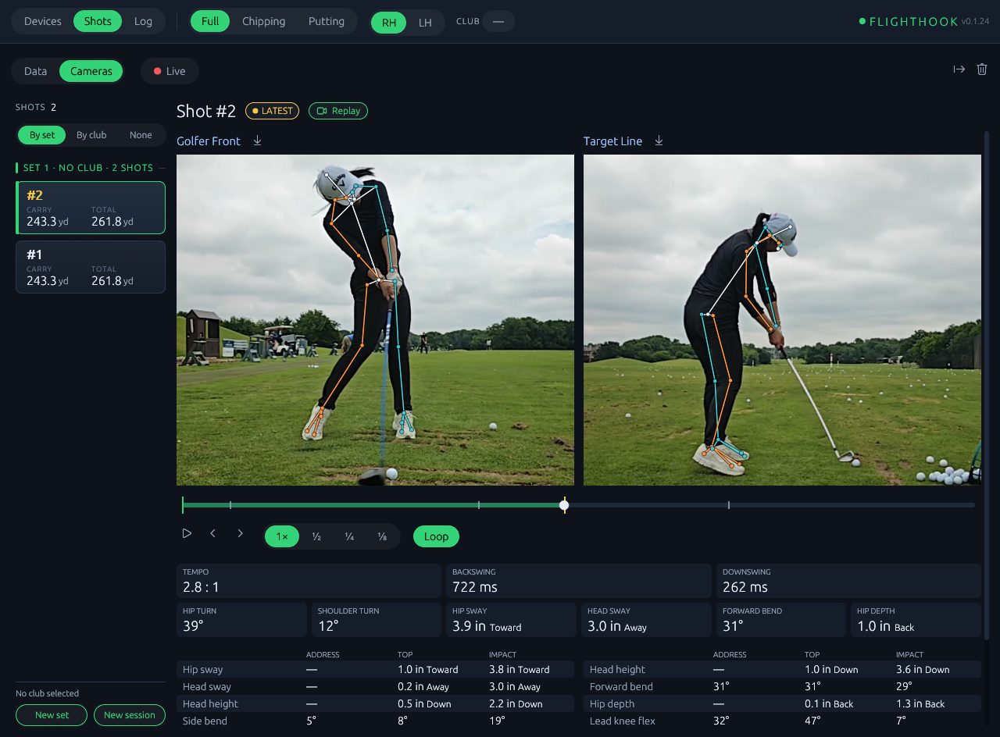

# Cameras

**Status: Beta** — swing replay: USB cameras record a clip of every shot,
and the Shots tab plays it back beside the shot's numbers. The Shots tab's
**Cameras** pane plays each shot's clips and shows each camera live.
**Body tracking** (alpha) draws the golfer's skeleton over the live pictures
and the replays, and measures each swing: tempo, the swing's key moments and
body angles.

flighthook keeps the last few seconds from each camera in memory. When a
launch monitor reports a shot, it cuts a clip from a few seconds before the
estimated impact to a moment after the report, saves it, and marks the shot
with a replay button. Capture uses the
[stance](https://github.com/divotmaker/stance) crate.

## What you need

- A USB (UVC) camera with an MJPEG mode: most webcams (a Logitech C920 at
  1080p30), and machine-vision boards (720p at 120 fps) for slow motion.
  Frames are stored as the camera compressed them, so recording costs
  almost no CPU.
- Windows or Linux. **macOS is not supported yet**: the camera type is not
  offered there, and a camera card configured by hand shows
  "cameras are not supported on macOS yet".
- Disk space: see [Disk and memory](#disk-and-memory).

## Setup

1. Devices tab → **Cameras (+)** → **Camera**.
2. On the new card's Settings side, pick the **Camera** from the list
   (**Test pattern** is a generated picture for trying it out), its
   **Position**, and the **Video mode**: **Auto** takes the highest frame
   rate, then the largest size; or pick one of the camera's modes.
3. **Save**. The card turns green once frames arrive; its telemetry shows
   the resolution, the frame rate achieved and dropped frames.
4. **Still frame** on the Telemetry side shows the camera's current picture,
   for aiming it.
5. For a camera on its side, set its **Rotation**; for one that doesn't face
   the golfer square on, its **Yaw** and **Pitch** (see
   [Rotation, yaw and pitch](#rotation-yaw-and-pitch)).

Add one card per camera. Clip settings are on the **Replay** card under
General.

```toml
[camera.0]
name = "Golfer Front"
camera = "/dev/v4l/by-id/usb-046d_HD_Pro_Webcam_C920_8A2B3C4D-video-index0"
camera_name = "HD Pro Webcam C920"
position = "golfer_front"  # target_line | golfer_front | golfer_back | overhead
mode = "auto"              # or e.g. "1280x720@120"
# latency_s = 0            # seconds a frame is old when it arrives, 0 to 10; see Camera latency
# rotation_deg = 0         # 0, 90, 180 or 270: turns the picture clockwise
# yaw_deg = 0              # degrees off square, -30 to 30
# pitch_deg = 0            # degrees tilted down from level, -30 to 30

# optional; shown at its defaults
[replay]
keep_shots = 20          # clips kept on disk, newest first
pre_roll_s = 4.0         # seconds before the estimated impact, 0 to 10
post_roll_s = 1.5        # seconds after the shot is reported, 0 to 10
start_before_impact_s = 2.0  # where a replay starts, before the estimated impact, 0 to 10
shot_cards = true        # camera cards in the Shots tab's Cards view
# clip_dir = "D:/swings" # default: flighthook/clips in your local data folder
```

`camera` is the camera's stable id: on Windows its device path, on Linux its
`/dev/v4l/by-id` link (or its USB port and name, for identical cameras
without serial numbers). It stays the same when the camera is unplugged and
plugged into the same USB port, and across reboots. If the id is not
connected, flighthook looks for a camera named `camera_name` and logs a
warning when it uses one.

## Positions

| Position | Where the camera stands |
| --- | --- |
| Target Line | behind the golfer's hands, looking down the target line |
| Golfer Front | facing the golfer's chest |
| Golfer Back | looking at the golfer's back |
| Overhead | above the golfer, looking down |

The position labels the camera in the replay and in each clip's `shot.json`.

## Rotation, yaw and pitch

The camera's card has three more fields on its **Settings** side:
**Rotation** right under the camera, so a quick setup needs no scrolling,
and **Yaw** and **Pitch** under **Latency**. Each applies as soon as the card
is saved; the camera keeps recording.

- **Rotation** (`0° | 90° | 180° | 270°`, `rotation_deg`) turns the camera's
  picture clockwise. A swing is taller than it is wide, so a face-on camera
  on its side fits the whole swing at about 2 m (6 ft) from the golfer, where
  an upright one needs about 3 m (10 ft). The picture is turned everywhere it
  is shown: the live view, the replay, the Cameras pane, the shot cards and
  the still frame. Body tracking works on the turned picture. Clips are
  stored as the camera sends them; the rotation is applied when they are
  played and tracked.
- **Yaw** (`yaw_deg`) is how far the camera points off square, in degrees,
  -30 to 30. Positive: the camera points to the right of the target line for
  a right-hander, for a Golfer Front and a Target Line camera alike.
- **Pitch** (`pitch_deg`) is how far the camera tilts down from level, in
  degrees, -30 to 30.

Empty Yaw and Pitch are 0. A value out of range shows its range under the
field and the card can't be saved; in the config file it is not used (a
warning in the log).

One camera measures turns and sways as they look from where it stands, so a
Golfer Front camera 5° or more off square shows one line over its swing
numbers: `Camera 7° off square: one-camera turn and sway are approximate`.

Close to the golfer the picture's perspective changes little when the golfer
is in the middle of it: about a degree on the turns at 2 m. A golfer off to
one side of the picture reads turned by about that offset over the distance,
so 7.5 cm off the middle at 2 m reads about 2° more open or closed.

## Replay

Shots with clips get a **Replay** button: on the shot's header in the Cards
view, and in a column of the Table view. Replay opens over the Shots tab with the
cameras side by side, synced on time, and a scrubber with the estimated
impact marked in gold. It opens already playing, looping, once the frames at its
start point have loaded. Pause, slow motion (1× · ½ · ¼ · ⅛), step frame by
frame, or drag the scrubber. A replay opens 2 s before the estimated impact
(`start_before_impact_s`, 0 to 10 s on the Replay card): a backswing and
downswing take 1.2 to 1.5 s, with a buffer. A green line on the scrubber
marks that point. **Loop** is on by default: playback that reaches the end of
the clip goes on from the start point. With Loop off it stops at the end, and
play restarts from the start point; drag the scrubber to reach the start of
the clip. Each camera has a download icon next to its name for its clip.

The Shots tab's **Cameras** pane plays the shot's clips too, in the page
rather than over it (see [Cameras pane](#cameras-pane)).

In the Cards view, each connected camera can also have a card beside the
range bars, when the window has room (click a card to cycle what it shows).
It loops the shown shot's clip from that camera at 1×, cropped to fill the
card, from the same start point to the end of the clip. Untick **Show video
on shot cards** on the Replay card (`shot_cards = false`) to leave the camera
cards out of the row; the clips are still recorded and replayable.

The browser fetches only the frames around the playhead, so a phone can
replay a long 120 fps clip. At 1× a phone may not decode every frame of a
120 fps clip in time: it skips frames and keeps the clip's pace. ½ and
slower show every frame.

## Cameras pane

**Beta.** With at least one camera added (on Windows or Linux), the Shots
tab gets a **Data | Cameras** switch at the start of the toolbar, in both
the Cards and the Table view. **Data** is the shots' numbers and charts, in
the Cards or Table view. **Cameras** shows the shot list on the left and
gives the whole page right of it to the cameras, the same from either view.
The choice is kept on this computer or browser. Next to it, **Data** has the
Cards | Table switch and **Cameras** a **Live** switch in its place; your
Cards | Table choice is kept for when you switch back, so picking **Data**
from Table returns to Table. In Table, each row's Replay button still opens
the replay over the page.

Each time the Cameras pane comes up (you pick **Cameras**, or come back to
the Shots tab with Cameras picked), it shows the latest
shot, or Live when there is no shot yet (under the device filter, when one
is set). Clearing the shot history while it shows turns Live on.

**A shot, in Cameras.** Pick a shot in the list (a new shot is picked as it
lands, as in Data). Its clips play side by side, each with the golfer's
skeleton while body tracking is on, looping from the replay's start point,
with the replay's controls: play and pause, frame steps, speed, Loop and the
scrubber. Under the clips are the tempo and the body at the frame on screen,
then under each clip that camera's swing numbers (see
[Swing analysis](#swing-analysis)), and the scrubber marks the swing events. The shot's **Replay** button still opens
the replay over the page. A shot without clips shows each camera's status
where its picture would be: **Waiting for the clip** for the newest shot
(clips are saved a moment after the shot), **No clip of this shot** for an
older one, and a camera that is not connected shows its status as on its
Devices card. The page scrolls when the numbers don't fit under the clips.

**Live.** Turn on **Live** to see every camera live, side by side, labeled
with its name and position, at up to 15 frames a second. With body tracking
in Live mode, each picture also has the golfer's skeleton and posture (see
[Live posture](#live-posture)) and a line under them reads out the
settings (see [Settings](#settings)); in the other modes it shows the
pictures alone. Under the pictures, a **Last shot** strip shows the newest
shot's swing once it is analyzed (in Live mode every clip is, a few seconds
after the shot): its number and club, the tempo, the six body tiles at each
camera's impact, colored, and the line naming the ones off their band (see
[Bands and colors](#bands-and-colors)). It stays until the next shot's
swing is in. A new shot doesn't take you
off Live; turn **Live** off (back to the shot the list shows), pick a shot,
or switch to **Data** to leave it. A camera that is not connected shows its
status as on its Devices card.

The live pictures are fetched only while Live is on and on screen:
another tab, the Table view, a minimized window or a hidden browser tab
stops them, and the cameras stop preparing live frames a few seconds later.
Recording clips is not affected either way.

## Body tracking (alpha)

**Alpha:** the skeleton, the swing numbers and the posture are early
estimates, there to look at and tune.

Body tracking finds the golfer's body in each camera's picture: 26 points
(head, neck, shoulders, elbows, wrists, hips, knees, ankles, heels and toes),
joined into a skeleton. The golfer's lead side (the left of a right-hander)
is drawn in teal, the trail side in orange, the head, neck and hips in
white. The **Body tracking** card under General holds its settings (see
[Settings](#settings)).

The mode decides when body tracking runs, and so what it costs:

| Mode | What runs | CPU |
| --- | --- | --- |
| **Off** (default) | nothing: the cameras record and replay clips only | none; no model is downloaded or loaded |
| **Historical** | a shot's clip is tracked the first time you view it | only when you view a clip not tracked yet |
| **Live** | the live views while you watch them, and every clip right after it is recorded | every clip of every shot, and each watched live view |

- **Historical:** when you view a shot in the Cameras pane or open its
  replay, each of its clips that has not been tracked yet is tracked then,
  and the result is kept beside the clip, so every later view is instant.
  The first view of a clip waits for it: the clip plays at once, and the
  skeleton and swing numbers appear a few seconds later (see [CPU](#cpu)),
  longer the very first time, while the models load. Live shows the
  pictures alone.
- **Live:** on **Live**, the skeleton is drawn over each camera's picture.
  Each picture comes with the skeleton found on it, so they always match;
  the live view runs as fast as body tracking keeps up, at most 15 frames a
  second. The hand is the one in the header (**RH | LH**). 3 seconds after
  each clip is saved, flighthook tracks the golfer on every frame of it,
  then measures the swing. A clip recorded before Live was on is tracked
  when you view it, as in Historical.
- **Off:** no skeleton and no swing numbers anywhere, also for clips
  tracked earlier. The clips play as usual.

A tracked clip (in the Cameras pane and in the replay) shows the skeleton on
every frame, in slow motion and frame by frame too, with the hand the shot
was hit with, and the Cameras pane shows its swing numbers.



*Swing footage: Wikimedia Commons, CC0 1.0. Shown with flighthook's overlays:
pose skeleton and swing data.*

### Turning it on

Body tracking is **Off** until you turn it on. When you pick **Historical**
or **Live** on the Body tracking card while it is Off, flighthook first
checks whether its models are on this computer:

- **They are:** the mode is saved at once.
- **They are not:** a dialog says what would be downloaded and asks first.
  It names the pose model (RTMPose-m, or RTMPose-s if picked) from
  `download.openmmlab.com` and the YOLOX-Tiny person detector from
  `github.com`, their sizes (about 76 MB in all with RTMPose-m, 43 MB with
  RTMPose-s), and the folder they are kept in, and that body tracking runs
  entirely on this computer afterward. **Cancel** leaves body tracking off
  and saves nothing. **Download** saves the mode and starts the download.

While it downloads, a window shows a bar for each file and one for the
whole download, in MB, and the host it is coming from. Your firewall may ask
at this point whether flighthook may connect to the internet: this download
is the only connection body tracking makes. The window's **Cancel** stops
the download, deletes the partial file and turns body tracking off again.
When the download is done, the window closes by itself and body tracking
starts. If the download fails, the window says why and offers **Retry** and
**Turn off**; a firewall or proxy blocking flighthook is the usual cause.

flighthook never downloads a model on its own. If body tracking is on but
its models are missing (the config file was edited by hand, the models were
deleted, or the other model was picked), the same dialog appears the first
time you open something that needs them: a shot's clips in the Cameras
pane, **Live** in Live mode, or a replay. Until they are downloaded there is
no skeleton.

Turning body tracking on from Off saves the mode at once; every other change
on the card (the mode between Historical, Live and Off, and every other
field) is saved with the card's **Save**.

### Switching modes

The mode applies at once, without restarting a camera. Leaving Live stops
the live tracking and the tracking of recorded clips still waiting (a clip
being tracked finishes); Off also forgets the clips waiting to be tracked
and releases the models from memory; a model download running stops too.

In Live mode, while the models are not ready, the live pictures say so at
the bottom: **Body tracking models not downloaded**, **Downloading body
tracking models**, **Loading body tracking models**, or **Body tracking
failed:** and why. The pictures keep going
meanwhile. If a camera's live body tracking keeps failing, it stops for that
camera and says so the same way, until you leave Live for a few seconds.

### Swing analysis

For each clip from a camera at **Golfer Front** (face-on) or **Target Line**
(down the line), flighthook measures the swing from the golfer's points and
shows it under the clip in the Cameras pane. A camera at **Golfer Back** or
**Overhead** gets the skeleton only.

- **Tempo:** backswing (takeaway to top) against downswing (top to impact),
  e.g. `2.9 : 1`, and each in milliseconds. The cameras film the same swing,
  so with several cameras the tempo is their average: one row of tiles
  across all the clips, the mean backswing, the mean downswing and the ratio
  of those two. A camera that measured no tempo is left out.
- **At the frame on screen:** under the tempo, a row of six tiles shows
  the body at the replay's position, and follows it as it plays, steps a
  frame or is scrubbed: **Hip turn**, **Shoulder turn**, **Hip sway** (how
  far the hips moved sideways since address), **Head sway** (how far the
  head moved sideways since address) from the face-on camera, and
  **Forward bend** and **Hip depth** (how far the hips moved toward the
  ball since address) from the down-the-line camera.
  Each camera is read at the frame its own picture shows. Without a
  down-the-line camera the spine tile is the face-on **Side bend**; a tile
  whose view no camera has, a moment outside a camera's clip and a point not
  found show a dash. Values read as in the metrics tables.
- **Direction words:** the body's moves from address show a distance and
  a direction instead of a sign, for left- and right-handers alike. Hip
  sway and head sway read **Toward** the target (`3.8 in Toward`) or
  **Away** from it (`1.1 in Away`); hip depth reads **Toward ball**
  (`1.2 in Toward ball`) or **Back** from it (`0.8 in Back`); head height
  reads **Up** or **Down** (`2.1 in Down`). A distance that rounds to 0 has
  no word.
- **Metrics tables:** under each clip, its camera's metrics, below the
  tiles.
- **Swing events:** address, takeaway, lead arm back (the lead arm parallel
  to the ground in the backswing), top, lead arm down (the same in the
  downswing), impact and finish. They are
  marked on the scrubber, not listed: impact is the gold tick, and the
  others are small gray ticks (hover one for its name, click it to jump to
  it). A tick sits at the average of the times the cameras found that event
  at, or at the one camera's time when only one found it, and there is none
  for an event no camera found. flighthook starts from the
  launch monitor's impact, moved by its
  [camera timing](#setting-the-camera-timing), and takes impact where the
  golfer's hands bottom out within 0.3 s of it.
- **Metrics** at address, top, impact and finish, for the camera's view,
  and at lead arm back and lead arm down too when the clip's column is wide
  (560 points or more). A dash is a value not measured at that point.

When the hands show no swing within 0.3 s of the launch monitor's impact,
the clip shows **No swing found in this clip** instead of numbers. That
usually means the camera timing is off by more than that, or the clip
doesn't show the swing.

The log records, for each shot and camera, how far the impact found from
the hands is from the camera timing's estimate (`swing impact -40 ms from
the clip's`), or that no swing was found near it, with the launch monitor,
its camera timing and the camera's latency. A difference that stays the
same shot after shot is a correction to that launch monitor's camera
timing: `swing impact -40 ms` means the impact came 40 ms earlier than
estimated, so raise its camera timing by 0.04 s; `+40 ms`, lower it by as
much.

| Face-on metric | What it is |
| --- | --- |
| Hip sway | how far the hips (their midpoint) moved sideways since address, toward or away from the target, at the top and impact |
| Head sway | how far the head moved sideways since address, toward or away from the target, at the top and impact |
| Head height | how far the head moved up or down since address, at the top and impact (also down the line) |
| Side bend | the spine (hips to shoulders) from vertical, sideways: positive with the shoulders away from the target |
| Shoulder tilt | the shoulder line from horizontal, positive with the lead shoulder higher, at address and impact |
| Lead elbow | the lead arm's angle at the elbow, 180° straight |
| Stance width | the feet's width over the shoulders' width, at address |
| Hip turn | how far the hips have turned since address, estimated from how much narrower they look, at the top and impact |
| Shoulder turn | the same for the shoulders |

| Down-the-line metric | What it is |
| --- | --- |
| Forward bend | the spine (hips to shoulders) from vertical, leaning toward the ball |
| Hip depth | how far the hips (their midpoint) moved toward the ball or back from it since address, at the top and impact |
| Lead knee flex, Trail knee flex | how far the knee is bent, 0° straight |
| Trail elbow | the trail arm's angle at the elbow, 180° straight |
| Hand height | how high the hands are above the trail shoulder, at the top |

Every number is a **2D estimate from one camera**: an angle or a distance
in that camera's picture, not in 3D. A move toward or away from the camera
doesn't show, and a turn shows only as a narrower body. The camera's aim
matters: face-on square to the target line, down the line along it.

**Hip turn and shoulder turn** come from that narrowing: a body turned by an
angle looks narrower by its cosine, so the turn is the angle whose cosine is
the hips' (or shoulders') width now over their width at address. Their
limits:

- The hips and shoulders must be square to the camera at address; any angle
  they already had then is read as part of the turn. Stay at the same
  distance from the camera.
- They don't say which way the body turned, so a turn back past square
  (the hips open at impact, say) reads as a turn the same way.
- The more the body turns, the more the far hip or shoulder is hidden and
  guessed, a body seen side-on still shows its depth, and the forward bend
  tilts the shoulder line rather than shortening it, so large turns read
  low: a full shoulder turn at the top often reads 50 to 65°.
- Near 90° a few pixels move them by many degrees, and a turn past 90° reads
  as less, so there is no value at the finish.
- A width wider than at address has no turn: no value.

Distances are a share of the golfer's torso length (`5% torso`). With the
**Height** set on the Player card (see [Player](#player)), they are in
inches or centimeters, following the Units switch.

Over a Golfer Front camera's numbers, a line says when the camera points 5°
or more off square (see [Rotation, yaw and pitch](#rotation-yaw-and-pitch)).

The swing is measured for the hand the shot was hit with. If the swing
looks clearly like the other hand's, flighthook logs a warning: a camera
whose picture is mirrored (many webcams mirror by default) makes a
right-hander look left-handed.

### Bands and colors

The swing numbers are colored by how they compare with **published tour
averages**: Sportsbox AI's tour tables, GEARS tour data, K-Vest PGA norms
and published swing studies, collected in stance's
[band table](https://github.com/divotmaker/stance/blob/main/docs/NORMS.md).
Each band is an average ± one spread (SD) for a metric at a key position,
for the club the shot was hit with (driver; woods, hybrids and irons;
wedges, which use the iron bands where there is no wedge band) and the
player's sex on the Player card (see [Player](#player)). A putter or a shot
without a club is not colored.

**Tour | Amateur**, next to the **Live** switch in the toolbar while the
Cameras pane shows, picks the bands: tour players, or mid-handicap amateur
golfers (fewer metrics have amateur bands). The choice is kept on this
computer or browser.

Four numbers at impact depend on the shot's shape: hip turn, shoulder turn,
shoulder tilt and hip sway. A fade swing has the hips and shoulders a little
more open at impact than a draw swing, so these have two bands, a fade band
and a draw band, each the average moved a little one way (3° for the turns
and the shoulder tilt, 0.75 in for the hip sway; an inference from the
studies, not a measured band). The color says which band a number is in:

| Color | Means |
| --- | --- |
| Aqua | inside the band: for the four shape numbers, inside both the fade and the draw band |
| Blue | inside the fade band only: good for a fade |
| Green | inside the draw band only: good for a draw |
| Yellow | outside, within 2 SDs of the nearer band |
| Red | further out |

Every other number has one band and reads aqua, yellow or red. A number
without a band stays white.

**The words.** A color never stands alone:

- A tile keeps its number and its word in the color: a graded turn reads
  **Open** or **Closed** (`39° Open`), a move from address keeps its own word
  (`3.9 in Toward`), and any other number off its band gets the word for its
  side (`29° Less`).
- Under the tiles, one line names each tile off its band and why: blue and
  green say which side (`Hip turn more open: fade side`), yellow and red what
  that miss tends to produce (`Head sway further away from the target than
  tour: head falls back, flip`). The line is empty when every tile is inside.
- In the metrics tables the number is colored; hover it for its band and
  words: `Tour · fade 36–46° · draw 30–40° · 44° Open · more open: fade side`.
  Bands in inches follow the Units switch (rounded after the conversion).

**When.** A band belongs to a key position (address, lead arm back, top, lead
arm down, impact, finish), so a tile is colored when the frame on screen is
the frame of one of those events of that camera's swing, or one frame either
side: pause on the impact tick, or step onto the top, and the tiles color;
elsewhere they are white. The tables and the tempo are always colored, and
so is the Live view's Last shot strip, which shows impact. A
tile that averages two cameras takes the color they share, and none when
they differ; the tempo takes the face-on camera's.

**What is not colored.** A turn measured by one camera is colored at impact
only: at the top one camera reads it well short of its 3D value (see
[Swing analysis](#swing-analysis)), so it would be red for everyone. The side
bend at the finish has a band but is not colored yet. Distances are put into
inches with the Player card's height, or a typical height for the sex (177 cm
men, 164 cm women) without one, so set it. Each number is still a one-camera
estimate, compared with averages mostly measured in 3D: read the colors as
a guide, not a verdict.

### Live posture

On **Live**, in Live mode, under each Golfer Front or Target Line camera's
picture, a row of numbers shows the golfer's posture on the picture shown, smoothed like
the skeleton:

- **Face-on:** side bend, shoulder tilt and lead elbow.
- **Down the line:** forward bend, lead knee flex, trail knee flex and
  trail elbow.

They are measured as in the swing analysis, for the hand in the header. A
dash is a point not found.

### Settings

The **Body tracking** card under General holds every body tracking setting,
in this order, saved with its **Save** like the other General cards:

| Field | Does |
| --- | --- |
| **Mode** | Off, Historical or Live (see the modes above) |
| **Model** | RTMPose-m or RTMPose-s (see [Models](#models)) |
| **Show skeleton** | draw the skeleton over the live views, the shots' clips and the replay (on by default) |
| **Minimum score** | the score a point needs to be drawn, 0 to 1 (default 0.3); higher hides more of the uncertain points |
| **Smoothing** | smoothing of the live skeleton, in Hz: 0 is off, else 0.1 to 10 (default 1). Lower is steadier at address and lags more in the swing |
| **Detect every** | how often the live view looks for the golfer afresh, 1 to 60 frames (default 10); in between it follows them from the last frame |

The fields show in every mode. A value out of range shows its range under
the field, and the card can't be saved until it is fixed.

On **Live**, in Live mode, a line under the pictures shows the values in
effect and, for each camera, the live frame rate and how long body tracking
takes per frame:

```text
RTMPose-m · min score 0.30 · smoothing 1.0 · detect every 10 · Face On 14.8 fps 36 ms · Down the Line 14.6 fps 34 ms
```

A change applies as soon as it is saved, and nothing restarts. Smoothing
and the look-again interval are for the live view; recorded swings always
keep the model's own points, looked for every 10 frames. The values are in
the config file too, each left out while at its default:

```toml
[body_tracking]
mode = "historical"    # "off" (default), "historical" or "live"
model = "rtmpose-m"    # or "rtmpose-s"
min_score = 0.3        # 0 to 1
smoothing = 1.0        # 0 (off), or 0.1 to 10
detect_every = 10      # 1 to 60
show_skeleton = true   # or false
```

A value out of range is refused when saved, and the default is used (with a
warning in the log) when it is in the config file. A `mode` or `model` that
is not one of the listed names makes the whole file fail to parse: the app
shows the line and message in an error frame, runs on the defaults, and the
first settings save copies the file to a backup before replacing it. A config file from
before the modes may hold `enabled` instead of `mode`: `enabled = false`
reads as `off` and `enabled = true` as `historical`, and the file is
rewritten with `mode` (the original kept beside it as a backup).

### Player

The **Player** card under General holds facts about the player, saved with
its **Save** like the other General cards:

| Field | Does |
| --- | --- |
| **Sex** | Men's (default) or Women's: whose tour averages the swing is compared with |
| **Height** | the player's height, in inches with Imperial default units and centimeters with Metric, 100 to 250 cm; with it, swing distances are in inches or centimeters (see [Swing analysis](#swing-analysis)). Empty is no height |

```toml
[player]          # left out while at its defaults
sex = "female"    # "male" (default) or "female"
height = 180      # cm, 100 to 250; not set by default
```

A height out of range is refused when saved, and not used (a warning in the
log) when it is in the config file. A config file with `golfer_height` in
`[body_tracking]` loads it as the player's height, and the file is rewritten
with `[player] height` (the original kept beside it as a backup).

### Models

Body tracking runs two models on this computer's CPU:

| Model | Finds | Size | License |
| --- | --- | --- | --- |
| RTMPose-m (default) or RTMPose-s, Halpe-26, by OpenMMLab | the 26 points of the golfer | 56 MB / 23 MB | Apache-2.0 |
| YOLOX-Tiny, by Megvii | where the golfer is in the picture | 20 MB | Apache-2.0 |

RTMPose-s is lighter and faster, RTMPose-m steadier on a blurred
downswing. The RTMPose weights are OpenMMLab's own release, labeled
Apache-2.0; they were trained on public pose datasets whose terms are mixed,
some of them research-only.

The **Body tracking** card under General picks the model.

The models are not part of flighthook, and nothing is downloaded until you
confirm it in the dialog (see [Turning it on](#turning-it-on)). flighthook
then downloads the chosen model and YOLOX-Tiny from their official sources:
RTMPose from OpenMMLab's download server (`download.openmmlab.com`, as a
zip), YOLOX-Tiny from Megvii's GitHub release (`github.com`, which hands the
file over from `release-assets.githubusercontent.com`). That is about 76 MB
with RTMPose-m, a few seconds on a fast line. Each file is checked against
its known SHA-256 before it is used. They are kept in `models` beside the
clip folder: `%LOCALAPPDATA%\flighthook\models` on Windows,
`~/.local/share/flighthook/models` on Linux. The models load the first time
body tracking needs them: in Historical mode the first time you view a clip
that is not tracked yet, in Live mode as soon as a camera starts. Switching
to the other model needs its file too: the dialog asks for it the first time
something needs it. The model no longer in use is released from memory. A
failed download is not tried again on its own; **Retry** in the window
does. A download cut short (flighthook closed mid-download) is deleted
before the next one. To use body tracking without an internet connection,
copy `rtmpose-m-halpe26.onnx` (or `rtmpose-s-halpe26.onnx`) and
`yolox-tiny.onnx` into that folder: flighthook finds them and asks for
nothing.

### CPU

Off costs nothing. Historical costs nothing until you view a clip not
tracked yet, then that clip's tracking (below), once. Live tracks every
clip after every shot and each live view while it is watched.

Live views, in Live mode: a live view that no one watches costs nothing.
Measured on a 12-core desktop CPU (AMD Ryzen 9 7900X), one 1280×720 camera
watched at 15 frames a second:

| Model | CPU | Per frame |
| --- | --- | --- |
| RTMPose-m | about 1.7 cores | 36 ms |
| RTMPose-s | about 0.9 cores | 20 ms |
| Historical or Off | under 0.1 core | |

Each watched camera adds about as much again; a slower computer shows fewer
live frames a second instead of falling behind.

**Tracking a clip is not free.** In Live mode every clip of every camera is
tracked after each shot, whether or not anyone looks at it; in Historical
mode a clip is tracked when it is first viewed. So that this leaves room for
a simulator on the same computer:

- in Live mode, each clip starts no sooner than 3 s after it was saved,
  after the shot's own work; a clip you view in Historical mode starts at
  once (it is not the shot just hit), before any clip asked for earlier;
- it runs on a quarter of the computer's logical CPUs (at least one): 6 on
  a 12-core, 24-thread CPU, 3 on a 6-core, 12-thread one;
- it runs at below-normal priority on Windows and Linux, so the simulator
  and everything else running at normal priority come first;
- clips go one at a time.

On the 7900X with RTMPose-m that is about 11 ms of wall time a frame, so
2.1 s for a 6 s, 30 fps clip (180 frames, 1080×1080), 2.9 s for 260
frames at 720×720, and 5.1 s for a 2 s, 240 fps clip (460 frames); a
computer with fewer cores takes longer, in proportion. Each clip tracked
logs one line with its frames, wall time and threads, to compare computers:

```text
body tracking: camera.0 shot 550e8400-e29b-41d4-a716-446655440000: 240 frames in 2.3 s (12 threads) · 9.6 ms a frame, golfer on 238 frames
```

While a clip is
tracked it keeps those cores busy whenever nothing at normal priority wants
them. In Historical mode that is how long a clip's first view waits for
its skeleton and numbers. If more clips wait than are kept on disk, the one
waiting longest is skipped (logged). Switching the **Body tracking** card to
Off stops it.

### Files

Each tracked clip gets a `<camera>.pose.json` beside its `.avi` and `.json`:
the points on every frame (about 220 KB for 240 frames). A face-on or
down-the-line clip also gets a `<camera>.swing.json`: its swing events,
tempo and metrics, and every metric at every frame (about 55 KB for a
560-frame face-on clip). Both are deleted with their clip, by pruning
and by **Clear history**, and neither is in the export.

A clip keeps the tracking it was given: a newer flighthook does not track it
again by itself. Each clip's `shot.json` entry records the camera's
rotation and the body tracking version it was tracked with. When the
Cameras pane shows a clip tracked with another rotation than its camera's
now, it has the clip tracked again (once per clip until the app is
reloaded); the old skeleton and numbers go, and the clip shows the tracking
state until the new ones are in.
[`POST .../analyze?force=1`](../API.md#post-apishotsshot_idvideocameraanalyze)
tracks any clip again.

### Privacy

Body tracking runs entirely on this computer. No picture, clip, point or
number leaves it; the only network traffic is the one-time model download,
which happens only after you confirm it.

## When a clip starts and ends

A clip runs from `pre_roll_s` before the **estimated impact** to
`post_roll_s` after the shot's trigger time: when the launch monitor
reported the shot, or, for the ExPutt, the moment it saw the ball struck,
which it sends along with the putt's result.

A FlightScope (Mevo+, Gen2, Xi) reports the shot at impact, and the ExPutt
dates each putt at its strike. The others report once the shot is measured,
so flighthook estimates the impact a fixed time before their report: the
monitor's **camera timing**. Every launch monitor has a default, and the
default for a kind of monitor without a better-known value is 1.5 s. These
are **beta estimates**, to be measured with a camera:

| Launch monitor | Default camera timing |
| --- | --- |
| FlightScope Mevo+ / Gen2 / Xi | 0 s |
| ExPutt | 0 s |
| Square Golf Omni | 1 s |
| Garmin R10 | 2 s |
| Open Connect (Uneekor, ...) | 2.5 s |
| Any other launch monitor | 1.5 s |

With the default 4 s pre-roll the backswing is in the clip even when an
estimate is off by a second.

### Setting the camera timing

If a monitor's impact sits early or late in its clips, set its camera
timing: on the monitor's card, on the **Settings** side, **Camera timing**
takes seconds from 0 to 5. Empty uses the default, which the empty field
shows. In the config file it is `impact_lead_s` on the monitor's section:

```toml
[square.0]
name = "Square Golf Omni"
impact_lead_s = 0.8   # seconds, 0 to 5; leave it out for the default
```

A change applies to the next shot; the monitor and the cameras keep running.
A value outside 0 to 5 is refused when saved, and ignored (the default is
used) with a warning when it is in the config file. A clip's `shot.json`
records the timing used for each shot.

### Camera latency

A camera that delivers its frames late, such as a buffered network stream,
shows the swing after it happened: a frame arrives a second or more after
the moment it shows. **Latency** is that delay. On the camera's card, on the
**Settings** side, **Latency** takes seconds from 0 to 10; empty is 0. flighthook
dates every frame that much earlier than it arrived, so the clip lines up
with the launch monitor's report and with the other cameras. In the config
file it is `latency_s` on the camera's section:

```toml
[camera.1]
name = "Network camera"
camera = "..."
latency_s = 1.8   # seconds, 0 to 10; leave it out for none
```

To set it, hit a shot and open the replay. If the gold impact mark sits
before the club reaches the ball (the clip shows the swing late), raise
Latency until the mark sits on the impact; if it sits after the impact,
lower it. Change one thing at a time: **Camera timing** on the launch monitor is the other knob,
and moves every camera's mark for that monitor (how long the monitor takes
to report), where Latency moves one camera (how long the camera takes to
deliver). Set a USB webcam's latency to 0 unless its picture is measurably
behind.

A change applies at once to the frames that follow; the camera keeps running.
Frames that arrive during the change can be dropped or leave a gap of up to
the difference, so change it between shots. A clip with a latency finishes
that much later: the end of its window arrives late. A value outside 0 to
10 is refused when saved, and ignored (no latency) with a warning when it is
in the config file.

- Two launch monitors seeing one swing (reports from different monitors whose
  impact estimates are within 0.5 s) make **one clip**, shown on both shots.
- The same monitor reporting again ends the clip at that moment and starts a
  new one, so quick putts each get their own clip.
- **Auto-chip** shots are never recorded.
- If a camera stops during a clip, the clip is kept when it reached the
  impact (marked incomplete), and dropped when it didn't. The card shows
  RECONNECTING and the camera is reopened with the usual backoff.
- A camera delivering under half its frame rate for 10 s raises one warning:
  usually two cameras sharing a USB controller, or a long exposure in low
  light.

Cameras are synced on when each frame reached the computer, less the
camera's Latency, which includes each camera's driver delay: expect up to a
few tens of milliseconds between two cameras. Each camera notes a launch monitor's report within 10 ms of
its arrival, so the impact mark can sit a frame apart between cameras.

## Disk and memory

Clips are stored as recorded (MJPEG): about 10 MB per second at 1280×720 and
120 fps, so a 5.5 s clip is about 55 MB per camera; a 1080p30 webcam is
about 20 MB. **Two cameras × 55 MB × 20 clips ≈ 2 GB** at the defaults.
`keep_shots` (1 to 1000) counts clips, not shots: a swing two monitors saw
is one clip, and a trigger that read nothing records one too. Older clips
are deleted when a new one is saved, and when flighthook starts; a clip
another camera is still writing waits for the next one. A value out of
range in the config file is held to 1 to 1000, with a warning in the log.

Each camera keeps the pre-roll plus the longest camera timing in effect plus
0.5 s in memory: about 70 MB at 720p120 with the default 4 s pre-roll and an
Open Connect monitor's 2.5 s. With an ExPutt it keeps 5 s more than its
camera timing, because the ExPutt sends a putt seconds after the strike it
is dated at: a putt reported up to 5.5 s after its strike still gets the
whole pre-roll, a later one less of it.

Each clip is a folder in the clip folder (shown on the Replay card): one
`<camera>.avi` (plays in VLC, Kinovea, Windows Media Player) and
`<camera>.json` (frame times) per camera, and `shot.json` (the shots, launch
monitor kinds and cameras). Only folders flighthook named are ever deleted.
**Clear history** on the Shots tab deletes every clip.

Changing the clip folder (`clip_dir`) takes effect with the next clip. The
clips in the previous folder are left as they are, and flighthook does not
list or delete them: move or delete them yourself. Clips already in the
new folder are listed and count toward `keep_shots`.

Clips are never in the shot export.

## Privacy and your network

Swing video shows you. The web server has no password: anyone on your
network who can open the dashboard can watch your clips, the cameras'
stills, the cameras live and the body tracking points and numbers. On a shared network, set the Web Server card's Bind Address to
`127.0.0.1:5880`, which serves this computer only.
